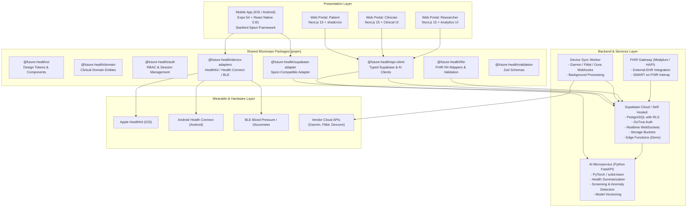
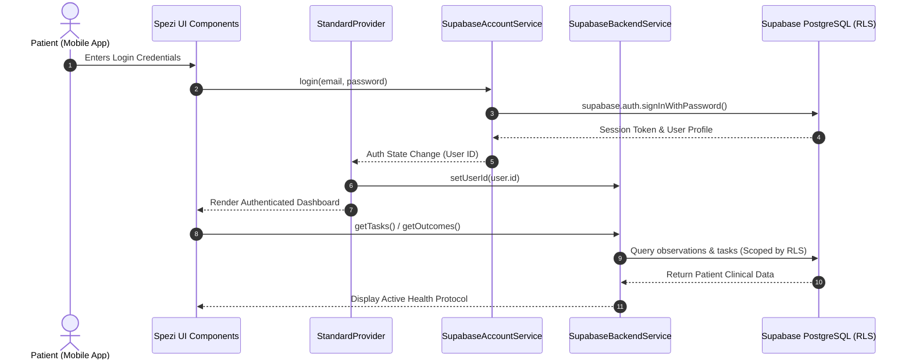
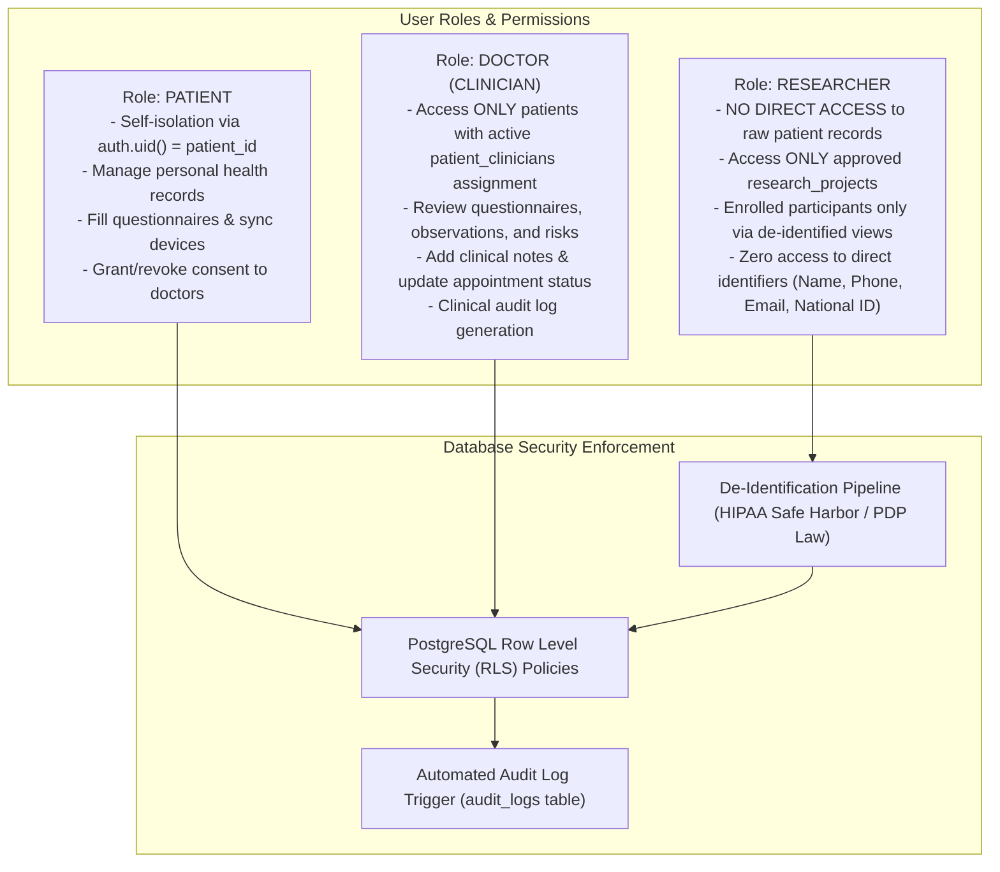

# FUTURE HEALTH - System Architecture

## 1. Executive Summary

**Future Health** is a cross-platform clinical digital health platform built on:
- **Mobile**: Stanford Spezi React Native template (Expo 54, React Native 0.81, TypeScript 5.9, Expo Router).
- **Web**: Next.js 15 (React 19, TypeScript, Tailwind CSS, shadcn/ui).
- **Backend**: Supabase (PostgreSQL 16, Supabase Auth, Storage, Realtime, Edge Functions).
- **Interoperability**: HL7 FHIR R4 dedicated mapping engine with optional Medplum gateway.
- **AI Engine**: Python FastAPI microservice (PyTorch, scikit-learn, synthetic screening, anomaly detection).
- **Device Integration**: Unified wearable adapter architecture (Apple HealthKit, Android Health Connect, BLE GATT, and vendor cloud APIs).



---

## 2. Stanford Spezi Architecture & Supabase Adapter

The mobile app follows Stanford Spezi's **Standard Pattern**:
1. **`AccountService` Contract**: Responsible exclusively for authentication lifecycle:
   - `initialize(): Promise<void>`
   - `isAuthenticated(): Promise<boolean>`
   - `getCurrentUser(): Promise<User | null>`
   - `login(credentials: LoginCredentials): Promise<void>`
   - `register(credentials: RegisterCredentials): Promise<void>`
   - `logout(): Promise<void>`
   - `resetPassword(email: string): Promise<void>`
   - `updateProfile(updates: UserProfileUpdate): Promise<void>`
   - `onAuthStateChanged(callback: (user: User | null) => void): () => void`

2. **`BackendService` Contract**: Responsible exclusively for clinical data persistence:
   - `initialize(): Promise<void>`
   - `setUserId(userId: string | null): void`
   - `loadSchedulerState(): Promise<SchedulerState | null>`
   - `saveSchedulerState(state: SchedulerState): Promise<void>`
   - `createTask(task: Task): Promise<Task>`
   - `updateTask(task: Task): Promise<Task>`
   - `deleteTask(taskId: string): Promise<void>`
   - `getTasks(): Promise<Task[]>`
   - `createOutcome(outcome: Outcome): Promise<Outcome>`
   - `getOutcomes(): Promise<Outcome[]>`
   - `saveQuestionnaireResponse(response: QuestionnaireResponse): Promise<void>`
   - `getQuestionnaireResponses(taskId?: string): Promise<QuestionnaireResponse[]>`
   - `syncToRemote(): Promise<void>`
   - `syncFromRemote(): Promise<void>`

3. **Coordination (`StandardProvider`)**:
   - `StandardProvider` wraps the React Native tree and binds `AccountService` and `BackendService`.
   - Whenever `AccountService` emits a user change (`login` or `logout`), `StandardProvider` automatically invokes `BackendService.setUserId(userId)`.
   - Our `SupabaseAdapter` (`SupabaseAccountService` and `SupabaseBackendService`) implements these exact interfaces, guaranteeing full drop-in compatibility with Spezi's existing UI screens (AccountOverview, SignInForm, RegisterForm, Questionnaires, Scheduler).



---

## 3. Multi-Role RBAC & Data Isolation Model

The platform serves three distinct user classes with strictly separated privilege boundaries:



### Role Access Matrix

| Resource / Action | Patient | Doctor (Assigned) | Doctor (Unassigned) | Researcher |
| :--- | :--- | :--- | :--- | :--- |
| **Self Profile** | Read / Write | Read (if assigned) | Denied | Denied |
| **Questionnaire Answers** | Read / Submit | Read / Review | Denied | De-identified Only |
| **Vital Observations** | Read / Insert (devices) | Read / Insert (clinical) | Denied | De-identified Only |
| **Clinical Notes** | Read (shared) | Read / Write | Denied | Denied |
| **Risk Assessments** | Read (clinician-approved) | Read / Validate / Flag | Denied | Aggregate Only |
| **Consents** | Manage own | Verify status | Denied | Verify study consent |
| **De-identified Export** | Denied | Denied | Denied | Export approved study |

---

## 4. Monorepo Architecture

The monorepo uses **pnpm workspaces** and **Turborepo** for caching, dependency resolution, and build pipelines:

```
c:\Users\PERSON\Sehat\
├── apps/
│   ├── mobile/                    # React Native Expo 54 App (Future Health Mobile)
│   └── web/                       # Next.js 15 Web Portal (Patient, Doctor, Researcher)
├── packages/
│   ├── ui/                        # Shared UI component primitives & Tailwind preset
│   ├── domain/                    # Canonical clinical domain types (Patient, Doctor, Observation, etc.)
│   ├── auth/                      # Role definitions, permission checks, session helpers
│   ├── supabase-adapter/          # Spezi-compatible AccountService & BackendService
│   ├── fhir/                      # HL7 FHIR R4 resources, mappers, validators, terminology
│   ├── device-adapters/           # HealthKit, Health Connect, BLE, and Vendor API abstractions
│   ├── api-client/                # Typed REST & WebSocket client for Supabase and FastAPI
│   └── validation/                # Zod schemas for clinical validation & form schemas
├── supabase/
│   ├── migrations/                # Version-controlled SQL DDL, indexes, and RLS policies
│   ├── functions/                 # Supabase Edge Functions (de-identification, webhooks)
│   └── seed/                      # Synthetic data seed for testing & demonstration
├── services/
│   ├── ai-engine/                 # Python FastAPI service for screening & anomaly detection
│   ├── fhir-gateway/              # Optional Medplum / external FHIR R4 interop gateway
│   └── device-sync-worker/        # Background queue worker for wearable provider APIs
├── docs/
│   ├── architecture/              # ARCHITECTURE.md and diagrams
│   ├── planning/                  # IMPLEMENTATION_PLAN.md
│   ├── security/                  # SECURITY_PLAN.md & threat modeling
│   └── fhir/                      # FHIR_DATA_MODEL.md & profile specifications
├── package.json                   # Root package.json defining workspaces
├── pnpm-workspace.yaml            # pnpm workspace configuration
├── turbo.json                     # Turborepo task pipeline definition
└── tsconfig.base.json             # Root TypeScript strict compiler options
```

---

## 5. Technology Stack Summary

| Domain | Technology | Version | Purpose |
| :--- | :--- | :--- | :--- |
| **Mobile Runtime** | React Native / Expo | RN 0.81.5 / Expo 54 | iOS & Android Patient experience |
| **Navigation** | Expo Router | 6.0.21 | Type-safe file-based mobile navigation |
| **Mobile Spezi** | Stanford SpeziVibe | 0.1.1 | Clinical modules (Scheduler, Questionnaire, HealthKit) |
| **Web Runtime** | Next.js (App Router) | 15.x / React 19 | Responsive Web Portal for all roles |
| **Web UI** | Tailwind CSS + shadcn/ui | Latest | Modern clinical SaaS design system |
| **Operational DB** | Supabase PostgreSQL | 16.x | Primary transactional clinical database |
| **Database Security** | Row Level Security (RLS) | Native PostgreSQL | Strict per-role data isolation |
| **FHIR Standard** | HL7 FHIR R4 | R4 (4.0.1) | Standardized healthcare data interchange |
| **AI Framework** | Python FastAPI / PyTorch | 3.12+ / PyTorch 2.x | Clinical screening, risk scoring, anomaly detection |
| **Wearables** | HealthKit & Health Connect | Native APIs | Consumer device data acquisition |
| **Package Manager** | pnpm + Turborepo | pnpm 11+ / Turbo 2.x | High-performance monorepo orchestration |

