# FUTURE HEALTH - FHIR R4 Interoperability & Data Model

## 1. Overview & FHIR R4 Strategy

**Future Health** implements an HL7 FHIR Release 4 (R4 v4.0.1) interoperability architecture.
To achieve high query performance, strict transactional integrity, and compliance:
1. **Operational Storage**: Optimized PostgreSQL relational tables with JSONB fields in Supabase for fast UI queries, filtering, indexing, and Row Level Security.
2. **FHIR Interoperability Engine (`packages/fhir`)**: A dedicated mapping and validation library that deterministically translates between relational database records and validated FHIR R4 JSON resources.
3. **FHIR Resource Store (`fhir_resources` table)**: An immutable ledger of exported FHIR Bundles and resources preserving historical provenance and versioning.
4. **External Interoperability Gateway (`services/fhir-gateway`)**: Optional Medplum / HAPI FHIR connector for external Hospital Information Systems (SIMRS), Electronic Health Records (EHR), and SATUSEHAT (Indonesian Ministry of Health FHIR platform) connectivity.

```mermaid
flowchart LR
    subgraph OperationalDB["Supabase PostgreSQL (Relational)"]
        ProfilesTbl["profiles\n(patient / doctor)"]
        ObservationsTbl["observations\n(vitals / lab results)"]
        QuestionnairesTbl["questionnaires &\nresponses"]
        ConsentsTbl["patient_consents"]
        AppointmentsTbl["appointments"]
        RiskTbl["risk_assessments"]
    end

    subgraph FHIRPackage["@future-health/fhir Mappings Engine"]
        Mappers["Bidirectional Mappers\n- toFHIR(dbRecord)\n- fromFHIR(fhirResource)"]
        Validators["Schema Validators\n(@medplum/fhirtypes / Zod)"]
        Terminology["Standard Vocabularies\nLOINC | SNOMED CT | UCUM | ICD-10"]
    end

    subgraph FHIRResources["HL7 FHIR R4 Resources"]
        PatientR["Patient & Practitioner"]
        ObservationR["Observation"]
        QuestionnaireR["Questionnaire &\nQuestionnaireResponse"]
        ConsentR["Consent"]
        AppointmentR["Appointment"]
        RiskAssessmentR["RiskAssessment"]
        DeviceR["Device"]
    end

    OperationalDB <--> FHIRPackage <--> FHIRResources
```

---

## 2. Resource Mapping Specifications

### 2.1 FHIR Patient & Practitioner <-> `profiles`

| FHIR R4 Element | Supabase `profiles` Column | Type / Format | Example / Mapping Rule |
| :--- | :--- | :--- | :--- |
| `resourceType` | Literal `'Patient'` or `'Practitioner'` | string | Based on `profiles.role` |
| `id` | `id` | UUID | Preserves Supabase Auth UID |
| `identifier[0].system` | `'https://futurehealth.id/patients'` | URI | Internal platform identifier |
| `identifier[0].value` | `patient_number` | string | e.g. `'FH-PT-100234'` |
| `name[0].use` | `'official'` | code | `'official'` |
| `name[0].given` | `name_components->'givenName'` | array of strings | `['Ahmad']` |
| `name[0].family` | `name_components->'familyName'` | string | `'Kusuma'` |
| `telecom[0]` (phone) | `phone_number` | string | `'+6281234567890'` |
| `telecom[1]` (email) | `email` | string | `'patient@example.com'` |
| `gender` | `gender` | code | `'male' \| 'female' \| 'other' \| 'unknown'` |
| `birthDate` | `date_of_birth` | date (YYYY-MM-DD) | `'1988-04-12'` |

---

### 2.2 FHIR Observation <-> `observations`

Observations capture physiological measurements (from HealthKit, Health Connect, Bluetooth devices, and manual clinician entry).

| FHIR R4 Element | Supabase `observations` Column | Terminology / Format | Example |
| :--- | :--- | :--- | :--- |
| `resourceType` | Literal `'Observation'` | string | `'Observation'` |
| `id` | `id` | UUID | UUID v4 |
| `status` | `status` | code | `'registered' \| 'preliminary' \| 'final' \| 'amended'` |
| `category[0].coding` | `category` | HL7 Observation Category | `http://terminology.hl7.org/CodeSystem/observation-category` -> `'vital-signs'` |
| `code.coding[0].system` | `coding_system` | URI | `'http://loinc.org'` |
| `code.coding[0].code` | `loinc_code` | string | `'8867-4'` (Heart rate) |
| `code.coding[0].display`| `display_name` | string | `'Heart rate'` |
| `subject.reference` | `patient_id` | FHIR Reference | `'Patient/' || patient_id` |
| `performer[0].reference`| `performer_id` | FHIR Reference | `'Practitioner/' || performer_id` or `'Patient/' || patient_id` |
| `effectiveDateTime` | `effective_datetime` | ISO 8601 string | `'2026-11-03T08:30:00Z'` |
| `valueQuantity.value` | `value_numeric` | numeric(10,2) | `72.0` |
| `valueQuantity.unit` | `unit` | string | `'beats/minute'` |
| `valueQuantity.system`| `'http://unitsofmeasure.org'` | URI | UCUM standard |
| `valueQuantity.code` | `unit_code` | string | `'/min'` |
| `component` | `components_jsonb` | array of components | Used for systolic + diastolic Blood Pressure |

#### Standard LOINC Vitals Vocabulary

| Measurement | LOINC Code | Display Name | UCUM Unit Code | UCUM Unit Label |
| :--- | :--- | :--- | :--- | :--- |
| **Blood Pressure Panel** | `85354-9` | Blood pressure panel with all children | `mm[Hg]` | mmHg |
| - Systolic BP | `8480-6` | Systolic blood pressure | `mm[Hg]` | mmHg |
| - Diastolic BP | `8462-4` | Diastolic blood pressure | `mm[Hg]` | mmHg |
| **Heart Rate** | `8867-4` | Heart rate | `'/min'` | bpm |
| **Oxygen Saturation (SpO2)**| `59408-5` | Oxygen saturation in Arterial blood by Pulse oximetry | `'%'` | % |
| **Body Temperature** | `8310-5` | Body temperature | `'Cel'` | °C |
| **Body Weight** | `29463-7` | Body weight | `'kg'` | kg |
| **Body Height** | `8302-2` | Body height | `'cm'` | cm |
| **Blood Glucose** | `2339-0` | Glucose [Mass/volume] in Blood | `'mg/dL'` | mg/dL |
| **Step Count** | `55423-8` | Number of steps in unspecified time Pedometer | `'1'` | steps |

---

### 2.3 FHIR Questionnaire & QuestionnaireResponse <-> `questionnaires` & `questionnaire_responses`

Standardized clinical surveys and patient-reported outcomes (PROMs) are modeled directly as FHIR R4:

| FHIR R4 Element | Supabase Column | Mapping Description |
| :--- | :--- | :--- |
| **Questionnaire.id** | `questionnaires.id` | Survey identifier (e.g. `'phq-9'`) |
| **Questionnaire.status** | `questionnaires.status` | `'draft' \| 'active' \| 'retired'` |
| **Questionnaire.item** | `questionnaires.items` (JSONB) | Hierarchical array of questionnaire questions, type, choices |
| **QuestionnaireResponse.id** | `questionnaire_responses.id` | Response UUID |
| **QuestionnaireResponse.questionnaire** | `questionnaire_responses.questionnaire_id` | Canonical URI or Questionnaire ID |
| **QuestionnaireResponse.subject** | `questionnaire_responses.patient_id` | Reference to `'Patient/' || patient_id` |
| **QuestionnaireResponse.status** | `questionnaire_responses.status` | `'in-progress' \| 'completed' \| 'amended'` |
| **QuestionnaireResponse.item** | `questionnaire_responses.answers` (JSONB) | Answers matching question `linkId` |
| **Calculated Score (Extension)**| `questionnaire_responses.calculated_score` | Calculated total score (e.g., PHQ-9 score 0-27) |

#### Standard Questionnaires Included

1. **PHQ-9 (Patient Health Questionnaire - 9)**:
   - LOINC Code: `44249-1`
   - Clinical Score: 0-4 minimal, 5-9 mild, 10-14 moderate, 15-19 moderately severe, 20-27 severe depression.
2. **GAD-7 (General Anxiety Disorder - 7)**:
   - LOINC Code: `70274-6`
   - Clinical Score: 0-4 minimal, 5-9 mild, 10-14 moderate, 15-21 severe anxiety.

---

### 2.4 FHIR Consent <-> `patient_consents`

The FHIR `Consent` resource models clinical consent, data sharing authorization, and research participation:

| FHIR R4 Element | Supabase Column | Notes |
| :--- | :--- | :--- |
| `resourceType` | Literal `'Consent'` | HL7 Consent |
| `id` | `id` | UUID |
| `status` | `status` | `'active' \| 'inactive' \| 'entered-in-error' \| 'rejected'` |
| `scope` | `scope` | `'patient-privacy'` or `'research'` |
| `category` | `category` | `59284-0` (Consent Document) |
| `patient` | `patient_id` | Reference to `'Patient/' || patient_id` |
| `dateTime` | `consented_at` | Timestamp of signature/consent |
| `provision.actor` | `authorized_actor_id` | Clinician ID or Organization ID granted access |
| `provision.period.end` | `expires_at` | Consent validity expiration |

---

### 2.5 FHIR RiskAssessment <-> `risk_assessments`

Models clinical risk screening performed by the Python AI Engine:

| FHIR R4 Element | Supabase Column | Notes |
| :--- | :--- | :--- |
| `resourceType` | Literal `'RiskAssessment'` | FHIR RiskAssessment |
| `id` | `id` | UUID |
| `status` | `review_status` | Maps `'pending_review'` to `'preliminary'`, `'approved'` to `'final'` |
| `subject` | `patient_id` | Reference to `'Patient/' || patient_id` |
| `occurrenceDateTime` | `created_at` | Generation timestamp |
| `basis` | `input_references` | Array of references to Observations & QuestionnaireResponses |
| `prediction[0].outcome` | `risk_category` | e.g. `'cardiovascular-risk-screening'`, `'depression-screening'` |
| `prediction[0].probabilityDecimal` | `risk_score` | Numeric confidence score ($0.00 - 1.00$) |
| `prediction[0].qualitativeRisk` | `risk_level` | `'low' \| 'moderate' \| 'high' \| 'critical'` |
| `note[0].text` | `clinical_summary` | Summary narrative and model limitations |
| `extension[model_info]` | `model_name` & `model_version` | Machine learning model provenance |

---

## 3. Data Integrity & Provenance Guarantee

Every FHIR resource exported or ingested through Future Health maintains:
1. **Source Tracking**: Marked with `meta.source` indicating either `'device/healthkit'`, `'device/health-connect'`, `'device/ble'`, `'portal/patient'`, or `'portal/clinician'`.
2. **Version Independence**: The internal database record updates an integer `version` incremented on every modification, mapped directly to `meta.versionId`.
3. **Lossless Transformation**: All clinical attributes map bidirectionally between PostgreSQL and FHIR JSON without data loss.

