# FUTURE HEALTH - Implementation Plan

## 1. Roadmap Overview & Milestones

This document specifies the execution plan for building the Future Health digital health platform. Development is organized into 10 structured milestones.

```mermaid
flowchart LR
    M1["M1: Starter & Template"] --> M2["M2: Monorepo & Web App"]
    M2 --> M3["M3: Supabase & Auth"]
    M3 --> M4["M4: RBAC & Profiles"]
    M4 --> M5["M5: Clinical DB & FHIR"]
    M5 --> M6["M6: Forms & Observations"]
    M6 --> M7["M7: Wearables & HealthKit"]
    M7 --> M8["M8: AI Engine Microservice"]
    M8 --> M9["M9: Research & De-ID"]
    M9 --> M10["M10: Quality, Security & Launch"]
```

---

## 2. Milestone Breakdown & Detailed Tasks

### Milestone 1: Starter Inspection & Mobile Application Generation (Current Milestone)
- [x] **Task 1.1**: Clone and inspect Stanford Spezi repositories (`SpeziVibe` and `SpeziVibeReactNativeTemplate`).
- [x] **Task 1.2**: Inspect Spezi Standard pattern (`AccountService`, `BackendService`, `StandardProvider`).
- [x] **Task 1.3**: Execute official CLI generator to produce `future-health-mobile` with full feature set (`chat`, `scheduler`, `questionnaire`, `healthkit`).
- [x] **Task 1.4**: Inspect generated code, dependencies (Expo 54, RN 0.81, React 19, TS 5.9), and embedded Spezi skills.
- [x] **Task 1.5**: Draft core architectural and design blueprints (`ARCHITECTURE.md`, `IMPLEMENTATION_PLAN.md`, `SECURITY_PLAN.md`, `FHIR_DATA_MODEL.md`).
- [ ] **Task 1.6**: Present findings, compatibility assessment, and Milestone 1 summary for user sign-off.

### Milestone 2: Monorepo Restructuring & Next.js Web Application
- **Goal**: Unify mobile, web, and shared packages under a high-performance pnpm workspace with Turborepo.
- **Tasks**:
  1. Move `future-health-mobile` into `apps/mobile/`.
  2. Initialize `apps/web/` using Next.js 15 (App Router, React 19, TypeScript, Tailwind CSS, shadcn/ui).
  3. Initialize shared packages in `packages/`:
     - `packages/ui` (shared design tokens, colors, common UI types).
     - `packages/domain` (canonical types: User, Patient, Doctor, Observation, etc.).
     - `packages/auth` (RBAC types, permissions, roles enum).
     - `packages/validation` (Zod schemas for inputs, clinical records, FHIR payloads).
  4. Configure root `pnpm-workspace.yaml`, `turbo.json`, and root `package.json`.
  5. Configure Metro bundler in `apps/mobile/metro.config.js` with monorepo root node_modules and watch folders.
- **Deliverables**:
  - `apps/mobile/` and `apps/web/` compile independently within the monorepo.
  - Shared TypeScript packages consumed cleanly via workspace references (`workspace:*`).

### Milestone 3: Supabase Configuration & Authentication Adapter
- **Goal**: Deploy Supabase database foundation, configure Supabase Auth, and implement the custom Spezi Supabase adapter.
- **Tasks**:
  1. Setup Supabase migration structure in `supabase/migrations/`.
  2. Implement `00001_initial_schema.sql`:
     - `profiles` table extending `auth.users` with `role` enum (`patient`, `doctor`, `researcher`, `admin`).
     - PostgreSQL triggers for automatic profile creation on user signup (`on_auth_user_created`).
  3. Build `packages/supabase-adapter/`:
     - `src/client.ts`: Supabase client factory supporting web (`@supabase/supabase-js`) and mobile with `expo-secure-store` storage adapter.
     - `src/account-service.ts`: Implements Spezi `AccountService` interface using Supabase Auth.
     - `src/backend-service.ts`: Implements Spezi `BackendService` interface using Supabase PostgreSQL.
     - `src/profile-service.ts`: Manages profile CRUD and avatar uploads.
  4. Wire `SupabaseAccountService` and `SupabaseBackendService` into `apps/mobile/lib/services/backend-factory.ts` and `apps/mobile/lib/services/standard-context.tsx`.
- **Deliverables**:
  - Mobile app authenticates and registers accounts directly via Supabase Auth.
  - Web portal supports Supabase Auth login, registration, and session persistence.

### Milestone 4: Multi-Role RBAC & Profile Management
- **Goal**: Enforce strict data isolation and clinical authorization between patients, clinicians, and researchers.
- **Tasks**:
  1. Create database migrations for:
     - `organizations` and `organization_memberships`.
     - `patient_clinicians` (clinical doctor-patient assignment table).
     - `patient_consents` (patient consent records).
  2. Implement Row Level Security (RLS) policies:
     - Patients can only view/update their own profile.
     - Doctors can only view profiles of patients assigned in `patient_clinicians`.
     - Researchers have zero access to raw patient profiles.
  3. Build patient profile screen in mobile app and web portal.
  4. Build doctor dashboard patient list view with assignment checks in web portal.
- **Deliverables**:
  - RLS test suite verifying cross-tenant access attempts are rejected by PostgreSQL.
  - Clinician dashboard displaying assigned patients list with verification.

### Milestone 5: Clinical Database & FHIR R4 Mappings
- **Goal**: Implement clinical entity persistence and bidirectional HL7 FHIR R4 mapping engine.
- **Tasks**:
  1. Create database migrations for:
     - `observations` (LOINC codes, value_quantity, value_string, status, effective_datetime).
     - `conditions` (SNOMED CT / ICD-10 codes, clinical_status, verification_status).
     - `appointments` (clinician_id, patient_id, scheduled_start, scheduled_end, status).
     - `fhir_resources` (FHIR R4 resource audit log / store).
  2. Build `packages/fhir/`:
     - FHIR R4 TypeScript types (using validated `@types/fhir` or `@medplum/fhirtypes`).
     - Mappers:
       - `Observation` <-> Database `observations` (LOINC coding, standard units).
       - `Patient` <-> Database `profiles` (demographics, identifiers).
       - `Practitioner` <-> Database `profiles` (specialty, license).
       - `Appointment` <-> Database `appointments`.
       - `Consent` <-> Database `patient_consents`.
  3. Build optional `services/fhir-gateway/` supporting FHIR R4 bundle search and export.
- **Deliverables**:
  - Full bidirectional transformation between relational database and FHIR R4 schemas.
  - Unit tests verifying lossless conversion of clinical observations and patient records.

### Milestone 6: Questionnaires & Health Observations
- **Goal**: Support FHIR-compliant clinical surveys, questionnaires, and vital observation tracking.
- **Tasks**:
  1. Create migrations for:
     - `questionnaires` (FHIR Questionnaire JSON schema, title, status).
     - `questionnaire_responses` (FHIR QuestionnaireResponse JSON, item answers, score).
  2. Seed standardized clinical questionnaires:
     - PHQ-9 (Patient Health Questionnaire - Depression).
     - GAD-7 (General Anxiety Disorder).
     - General Health Intake / Medical History.
  3. Integrate Spezi `@spezivibe/questionnaire` in mobile app to fetch questionnaires and post responses to Supabase.
  4. Implement Web questionnaire response viewer for doctors (visual score, trend chart, answer breakdown).
  5. Implement observation logging (blood pressure, heart rate, blood glucose, SpO2, body temperature).
- **Deliverables**:
  - Patient can complete PHQ-9 and GAD-7 surveys on mobile; results stream immediately to Supabase.
  - Clinicians can review completed questionnaires and calculated risk scores in the web portal.

### Milestone 7: Wearable & Device Adapters (HealthKit & Health Connect)
- **Goal**: Implement unified device adapter architecture for continuous telemetry and vital streaming.
- **Tasks**:
  1. Build `packages/device-adapters/`:
     - Common `DeviceAdapter` interface (`checkAvailability`, `requestPermissions`, `syncData`, `disconnect`).
     - HealthKit adapter (iOS native via `@kingstinct/react-native-healthkit`).
     - Health Connect adapter (Android native via `react-native-health-connect`).
     - Generic BLE GATT adapter for Bluetooth blood pressure monitors and pulse oximeters.
     - Cloud vendor adapter interfaces (Garmin, Fitbit, Dexcom, Oura).
  2. Implement sync cursor and deduplication in Supabase (`device_measurements` table).
  3. Build Mobile Device Management screen to connect, view sync status, and trigger manual sync.
- **Deliverables**:
  - Live data sync from Apple Health (step count, heart rate, sleep duration) on iOS.
  - Architecture ready for Health Connect on Android and BLE medical sensors.

### Milestone 8: AI Engine Microservice (FastAPI + PyTorch)
- **Goal**: Build independent Python microservice for clinical screening, trend analysis, and anomaly detection.
- **Tasks**:
  1. Scaffold `services/ai-engine/`:
     - FastAPI application, Pydantic schemas, dependency injection.
     - Security middleware (JWT validation matching Supabase Auth).
  2. Implement clinical screening endpoints:
     - `POST /api/v1/screening`: Evaluates questionnaire scores and risk rules.
     - `POST /api/v1/health-summary`: Synthesizes timeline of recent observations and trends.
     - `POST /api/v1/anomaly-detection`: Statistical z-score and isolation forest on vital timeseries.
     - `POST /api/v1/questionnaire-analysis`: Generates structured clinical insights.
     - `GET /health`: Healthcheck endpoint.
  3. Implement **Clinician Review Workflow**:
     - AI outputs written to `risk_assessments` table with `review_status = 'pending_review'`.
     - Explicit medical disclaimers ("For clinical decision support only; not a diagnostic tool").
     - Model metadata tracking (model name, version, timestamp, input hash).
- **Deliverables**:
  - Working FastAPI service with comprehensive unit tests and OpenAPI documentation.
  - Doctor web interface allows reviewing, approving, or modifying AI-assisted risk assessments.

### Milestone 9: Researcher Portal & De-Identification Pipeline
- **Goal**: Provide ethical, compliant research tools with automated HIPAA Safe Harbor / Indonesian PDP Law de-identification.
- **Tasks**:
  1. Create database migrations for:
     - `research_projects` (title, IRB protocol number, description, lead_researcher_id, status).
     - `research_enrollments` (participant_code, consent_verified, enrollment_date).
  2. Implement De-identification Engine (Supabase Edge Function or Database View):
     - Removal of all 18 HIPAA direct identifiers (names, phone numbers, email addresses, exact dates shifted by random patient offset, zip codes generalized).
     - Generation of irreversible pseudonymous participant hashes.
  3. Build Researcher Web Portal:
     - Project dashboard with participant enrollment statistics.
     - Protocol and inclusion criteria viewer.
     - De-identified tabular dataset explorer.
     - Export to CSV format with signed audit log.
- **Deliverables**:
  - Researcher can inspect anonymized cohort data and export CSV files.
  - Zero possibility of researcher querying identifiable patient records.

### Milestone 10: Testing, Security Audit, Deployment & Documentation
- **Goal**: End-to-end verification, automated testing, security audit, and deployment configuration.
- **Tasks**:
  1. Monorepo end-to-end test suite (Playwright for Web, Jest/Testing Library for Mobile and packages).
  2. Security audit:
     - RLS policy penetration testing.
     - JWT expiration and revocation testing.
     - Input sanitization and OWASP Top 10 API validation.
  3. Prepare Docker configurations (`services/ai-engine/Dockerfile`, `apps/web/Dockerfile`).
  4. Complete technical documentation in `docs/`:
     - Deployment guide (Vercel for Web, EAS for Mobile, Supabase Cloud / Self-hosted).
     - Indonesian PDP Law No. 27/2022 and HIPAA compliance mapping document.
- **Deliverables**:
  - Clean test run across all monorepo components.
  - Fully documented, production-ready Future Health codebase.

---

## 3. Milestones Timeline & Verification Criteria

| Milestone | Key Deliverable | Success Criteria |
| :--- | :--- | :--- |
| **M1** | Spezi Starter Inspection & Architecture Blueprints | Starter runs, architecture and data model documents approved |
| **M2** | Turborepo Monorepo & Next.js Web App | Both apps build cleanly; shared packages link via pnpm workspaces |
| **M3** | Supabase Adapter & Authentication | User can sign up/in on mobile and web using Supabase Auth |
| **M4** | Multi-Role RBAC & Patient Profiles | RLS prevents unassigned clinician or patient cross-access |
| **M5** | Clinical DB & FHIR R4 Mappings | Bidirectional roundtrip test between DB records and FHIR R4 resources passes |
| **M6** | Questionnaires & Observations | PHQ-9 completed on mobile appears in real-time on doctor portal |
| **M7** | Wearable & HealthKit Integration | Apple Health vitals sync into database with deduplication |
| **M8** | Python AI Screening Engine | FastAPI service returns structured risk assessment with clinician review status |
| **M9** | Researcher Portal & De-Identification | Anonymized dataset generated with zero direct identifiers leaked |
| **M10** | E2E Testing, Auditing & Deployment | CI pipeline passes tests, builds Docker images, and verifies security |

