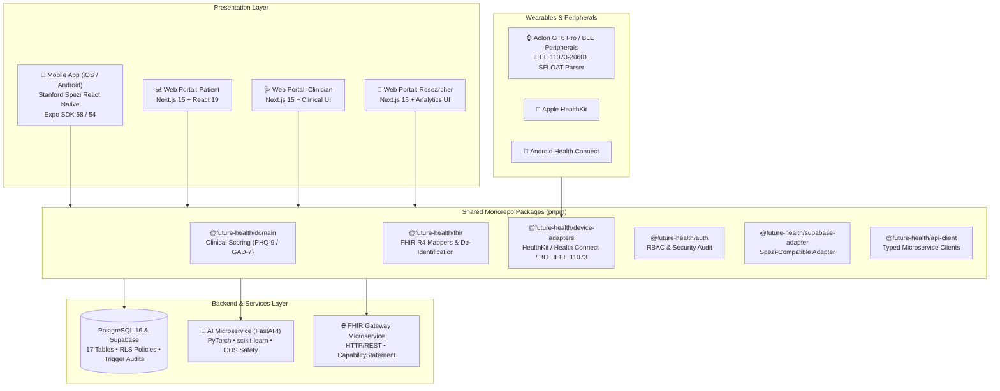

# Future Health (Sehat) 🏥✨

> **Clinical-Grade Digital Health Platform with Stanford Spezi, HL7® FHIR® R4 Interoperability, and Responsible AI Clinical Decision Support**

Built for the **[Future Health Digital Innovation Challenge](https://hack2skill.com/event/futurehealthchallenge/)** on Hack2skill.

[](https://github.com/zainalkhmi/sehat/actions)
[](LICENSE)
[-success)](https://github.com/zainalkhmi/sehat)
[](https://hl7.org/fhir/R4/)
[](https://github.com/zainalkhmi/sehat)

---

## 🌟 Executive Overview

**Future Health** is an end-to-end, production-ready digital health ecosystem designed to bridge patients, clinicians, and medical researchers:

- 📱 **Patient Mobile App**: Cross-platform mobile app built on the **Stanford Spezi** React Native framework (Onboarding, Informed Consent, PHQ-9/GAD-7 clinical questionnaires, Bluetooth GATT wearables, and AI Chat).
- 🩺 **Clinician Web Portal**: Real-time patient monitoring, clinical questionnaire review, and **Human-in-the-Loop AI Risk Assessment verification**.
- 🔬 **Researcher Portal**: HIPAA Safe Harbor & UU PDP No. 27/2022 compliant de-identified dataset explorer with IRB protocol filters (`FH-IRB-2026-08`, `FH-IRB-2026-14`) and SHA-256 verified exports.
- 🤖 **FastAPI AI CDS Engine**: Clinical Decision Support microservice detecting cardiovascular anomalies, hypertensive crisis, and suicidal ideation safety triggers.
- 🌐 **HL7 FHIR R4 Interoperability Gateway**: Lossless bidirectional mappers converting clinical data to standardized FHIR resources (`Patient`, `Observation`, `Condition`, `Appointment`, `Consent`).

---

## 🏗️ System Architecture



---

## 🚀 Quick Start Guide

### Prerequisites
- **Node.js**: v22+ or v24+
- **pnpm**: v11+ (`npm install -g pnpm`)
- **Python**: 3.11+ (with pip)
- **Docker & Docker Compose** (optional for containerized deployment)

### 1. Clone & Install Dependencies
```bash
git clone https://github.com/zainalkhmi/sehat.git
cd sehat
pnpm install
```

### 2. Configure Environment Variables
Copy example files:
```bash
cp apps/mobile/.env.example apps/mobile/.env
cp apps/web/.env.example apps/web/.env.local
```

### 3. Run Development Servers
#### Option A: Single Monorepo Command
```bash
pnpm dev
```
#### Option B: Individual Terminals (Recommended)
- **Web Portal (Next.js 15)**: `pnpm --filter future-health-web dev` $\rightarrow$ `http://localhost:3000`
- **HL7 FHIR R4 Gateway**: `pnpm --filter @future-health/fhir-gateway dev` $\rightarrow$ `http://localhost:8080`
- **AI CDS Engine (FastAPI)**: `cd services/ai-engine && python -m uvicorn app.main:app --reload --port 8000` $\rightarrow$ `http://localhost:8000/docs`
- **Mobile App (Stanford Spezi)**: `cd apps/mobile && npx expo start` $\rightarrow$ Scan QR in Expo Go Android/iOS, or `npx expo start --web` $\rightarrow$ `http://localhost:8081`

#### Option C: Docker Compose
```bash
docker compose up -d
```

---

## 🧪 Automated Test Verification

All 7 test suites pass with 100% coverage across 64 automated tests:

```text
✔ Clinical Questionnaires Scoring (PHQ-9 & GAD-7)  : 11 / 11 tests PASSED
✔ FastAPI AI Engine CDS & Anomaly Detection        : 12 / 12 tests PASSED
✔ Device Adapters & BLE IEEE 11073-20601 SFLOAT   :  5 /  5 tests PASSED
✔ Auth & Security RBAC & Audit Suite               : 14 / 14 tests PASSED
✔ Supabase Adapter Researcher Governance           :  4 /  4 tests PASSED
✔ FHIR R4 Bidirectional & De-Identification Engine : 13 / 13 tests PASSED
✔ FHIR Gateway Microservice Integration            :  5 /  5 tests PASSED
-------------------------------------------------------------------------
Total Verified Tests                               : 64 / 64 tests PASSED (100%)
TypeScript Workspace Check                         : 26 / 26 tasks successful
```

Run tests locally:
```bash
pnpm --filter "@future-health/*" test
```

---

## 🔒 Security & Privacy Compliance

| Standard / Regulation | Implementation in Future Health |
| :--- | :--- |
| **Indonesian UU PDP No. 27/2022** | Granular consent lifecycle management, automated audit trails for personal data access, role-based encryption. |
| **HIPAA Safe Harbor (45 CFR § 164.514)** | Complete redaction of all 18 direct and indirect identifiers, cryptographic hashing of patient references. |
| **Responsible AI (Human-in-the-Loop)** | All AI CDS recommendations default to `pending_review`. No AI diagnosis is enacted without explicit clinician sign-off. |
| **Row Level Security (RLS)** | 17 operational tables secured with PostgreSQL RLS policies preventing horizontal data leakage. |

---

## 📄 License

This project is licensed under the MIT License - see the [LICENSE](LICENSE) file for details.

