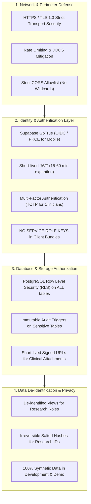

# FUTURE HEALTH - Security and Privacy Plan

## 1. Governance & Regulatory Framework

Future Health is designed to handle protected health information (PHI) and sensitive clinical data. This plan defines the security and privacy controls aligned with:
1. **Indonesian Personal Data Protection Law (UU No. 27 Tahun 2022 - UU PDP)**:
   - Specific personal data category (Data Kesehatan / Health Data) requires explicit consent (Persetujuan Tertulis) and heightened technical protection.
   - Rights of data subjects: right to access, rectify, revoke consent, and erase data.
   - Notification obligation: Breach reporting within 72 hours to authorities and data subjects.
2. **HIPAA Security & Privacy Rules** (Standard International Reference):
   - Administrative, Physical, and Technical safeguards.
   - De-identification standard (Safe Harbor method - removal of 18 direct identifiers).
3. **Medical Device Software Regulations** (Good Clinical Practice & Software as a Medical Device - SaMD considerations):
   - AI outputs classified as Clinical Decision Support (CDS), strictly requiring human-in-the-loop clinician validation. No autonomous prescription or diagnostic assertion.

---

## 2. Threat Model & Defense-in-Depth Architecture



---

## 3. Row Level Security (RLS) Architecture

Every clinical and profile table in PostgreSQL has RLS enabled with explicit `PERMISSIVE` and `RESTRICTIVE` policies. No query can bypass RLS without the `service_role` key (which is strictly restricted to server-side backend processes).

### Core Policies Blueprint

```sql
-- Enable RLS on all tables
ALTER TABLE profiles ENABLE ROW LEVEL SECURITY;
ALTER TABLE observations ENABLE ROW LEVEL SECURITY;
ALTER TABLE questionnaires ENABLE ROW LEVEL SECURITY;
ALTER TABLE questionnaire_responses ENABLE ROW LEVEL SECURITY;
ALTER TABLE patient_clinicians ENABLE ROW LEVEL SECURITY;
ALTER TABLE patient_consents ENABLE ROW LEVEL SECURITY;
ALTER TABLE research_projects ENABLE ROW LEVEL SECURITY;
ALTER TABLE research_enrollments ENABLE ROW LEVEL SECURITY;
ALTER TABLE risk_assessments ENABLE ROW LEVEL SECURITY;
ALTER TABLE audit_logs ENABLE ROW LEVEL SECURITY;

-- 1. Profiles Table Policy
-- Patient can view and update only their own profile
CREATE POLICY patient_self_profile ON profiles
    FOR ALL
    TO authenticated
    USING (id = auth.uid())
    WITH CHECK (id = auth.uid());

-- Clinicians can view profiles of assigned patients
CREATE POLICY doctor_assigned_profiles ON profiles
    FOR SELECT
    TO authenticated
    USING (
        EXISTS (
            SELECT 1 FROM patient_clinicians pc
            WHERE pc.clinician_id = auth.uid()
              AND pc.patient_id = profiles.id
              AND pc.status = 'active'
        )
    );

-- 2. Observations Table Policy
-- Patients can manage their own observations
CREATE POLICY patient_own_observations ON observations
    FOR ALL
    TO authenticated
    USING (patient_id = auth.uid())
    WITH CHECK (patient_id = auth.uid());

-- Assigned clinicians can view and insert clinical observations
CREATE POLICY clinician_assigned_observations ON observations
    FOR ALL
    TO authenticated
    USING (
        EXISTS (
            SELECT 1 FROM patient_clinicians pc
            WHERE pc.clinician_id = auth.uid()
              AND pc.patient_id = observations.patient_id
              AND pc.status = 'active'
        )
    )
    WITH CHECK (
        EXISTS (
            SELECT 1 FROM patient_clinicians pc
            WHERE pc.clinician_id = auth.uid()
              AND pc.patient_id = observations.patient_id
              AND pc.status = 'active'
        )
    );

-- 3. Research Isolation Policy
-- Researchers CANNOT select directly from raw observations or profiles!
-- Research queries MUST be executed against de-identified materialized views or RPCs.
```

---

## 4. Research Data Governance & De-Identification

Researchers never receive direct access to identifiable patient records.
When a patient consents to participate in an institutional research project (`research_projects`):

1. **Identifier Elimination (HIPAA Safe Harbor / UU PDP standard)**:
   - Removed: Name, address, phone number, email address, national identity number (NIK), medical record number, device serial numbers, biometric records, facial photos.
   - Date Shifting: Birth dates and observation timestamps are shifted by a per-patient pseudorandom delta between -180 and +180 days (preserving clinical intervals between tests while preventing date-correlation re-identification).
   - Age Grouping: Ages over 89 are grouped into `89+`.
2. **Pseudonymous Participant Code**:
   - Each enrollment generates a random participant identifier (e.g. `FH-RES-883921`) stored in `research_enrollments`.
   - The mapping between the participant code and the patient's actual UUID is stored in an encrypted lookup table accessible only by the Data Protection Officer / IRB Administrator.
3. **Audit Logged Exports**:
   - Every CSV or analytical export by a researcher is logged in `audit_logs` recording:
     `researcher_id`, `project_id`, `row_count`, `query_filter`, `ip_address`, `timestamp`.

---

## 5. Audit Logging Architecture

An immutable audit trail is maintained in the `audit_logs` table. Changes to clinical records, logins, consent modifications, and data access are captured via PostgreSQL triggers:

```sql
CREATE TABLE audit_logs (
    id UUID PRIMARY KEY DEFAULT gen_random_uuid(),
    actor_id UUID REFERENCES auth.users(id),
    action VARCHAR(50) NOT NULL, -- 'INSERT', 'UPDATE', 'DELETE', 'ACCESS', 'CONSENT_REVOKE'
    entity_table VARCHAR(100) NOT NULL,
    entity_id UUID NOT NULL,
    old_data JSONB,
    new_data JSONB,
    ip_address INET,
    user_agent TEXT,
    created_at TIMESTAMPTZ NOT NULL DEFAULT NOW()
);

-- Deny all updates and deletes on audit_logs (Append-Only)
CREATE POLICY audit_logs_read_admin ON audit_logs
    FOR SELECT TO authenticated
    USING (EXISTS (SELECT 1 FROM profiles WHERE profiles.id = auth.uid() AND profiles.role = 'admin'));

CREATE POLICY audit_logs_no_update_delete ON audit_logs
    FOR UPDATE OR DELETE TO authenticated
    USING (false);
```

---

## 6. Secrets Management & Credential Safety

1. **Client-Side Safety**:
   - Mobile and Web frontends ONLY have access to the public Supabase Anon key (`EXPO_PUBLIC_SUPABASE_ANON_KEY` / `NEXT_PUBLIC_SUPABASE_ANON_KEY`).
   - The Supabase `service_role` key is NEVER shipped in frontend client bundles, environment variables, or client repository code.
   - On mobile, authentication tokens and encryption keys are stored in `expo-secure-store` (iOS Keychain / Android Keystore with hardware encryption).
2. **AI Microservice**:
   - Python FastAPI service communicates with Supabase using signed service-to-service JWT tokens.
   - All external vendor API credentials (e.g., OpenAI, Google Gemini, Garmin OAuth) are kept in secure backend environment files (`.env`) or cloud key vaults (AWS Secrets Manager / Google Secret Manager).

---

## 7. AI Safety & Clinical Decision Support Protocol

1. **Non-Autonomous Principle**:
   - The AI engine is strictly an assistive Clinical Decision Support (CDS) tool.
   - AI outputs must never directly prescribe pharmaceuticals, modify treatment plans, or diagnose terminal/critical conditions without clinician confirmation.
2. **Explainability & Provenance**:
   - Every AI result generated records:
     - `model_name`: Identifies the exact model architecture (e.g. `future-health-screening-v1`).
     - `model_version`: SemVer string (e.g. `1.0.4`).
     - `input_references`: Array of FHIR observation / questionnaire response IDs used.
     - `risk_score`: Calibrated numerical confidence score ($0.0 - 1.0$).
     - `limitations`: Explicit text warning of screening boundaries.
     - `review_status`: Defaults to `pending_review`. Marked `approved`, `modified`, or `rejected` by the clinician with reviewer timestamp and notes.

